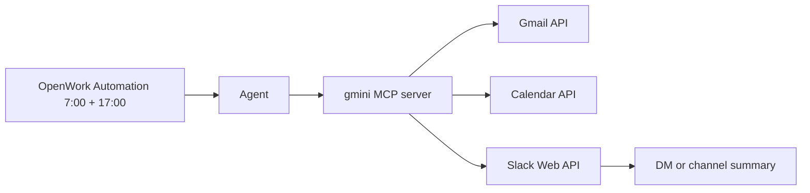
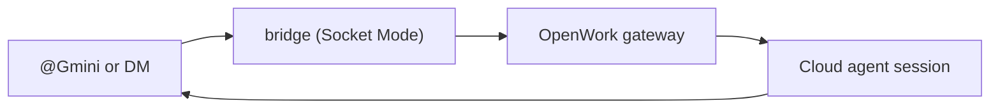

# gmini

**gmini** is an MCP server for a daily inbox routine: Gmail triage, a Google Calendar day view, and a five-section Slack summary.

Repository: https://github.com/rusuraluca/gmini

## What it does



- Gmail: fetch recent mail, read bodies, archive, star, label, mark read
- Calendar: list one day of primary-calendar events
- Slack: post a summary in five sections — *Today*, *To reply*, *Important*, *Top news*, *Clean up summary*

The agent (OpenWork + a scheduled Automation) decides what is noise, what is urgent, and what needs a reply. gmini only exposes the tools.

## Tools

| Tool | Action |
| --- | --- |
| `gmail_fetch_recent` | List recent messages: metadata + snippet |
| `gmail_get_message` | One message, decoded body |
| `gmail_archive` | Remove INBOX label (never deletes) |
| `gmail_mark_read` | Remove UNREAD label |
| `gmail_star` | Add STARRED label |
| `gmail_apply_label` | Apply a label by name, creating it if missing |
| `gmail_list_labels` | List system and custom labels |
| `calendar_fetch_today` | One day of primary-calendar events |
| `slack_send_message` | Post to `#channel`, channel id, or user id (DM) |

## Quick start

```bash
git clone git@github.com:rusuraluca/gmini.git
cd gmini
npm install
cp .env.example .env
```

### Google

1. Cloud Console: create a project, enable **Gmail API** and **Calendar API**.
2. OAuth consent screen (External), add your Gmail address as a test user.
3. Credentials → OAuth client ID → Desktop app → client ID and secret into `.env`.
4. `npm run auth:google` — browser consent, writes `.tokens/google-token.json`.

Scopes: `gmail.modify` (cannot delete or send), `calendar.readonly`, `userinfo.email`. Upgrading an older token? Re-run step 4.

### Slack

1. [api.slack.com/apps](https://api.slack.com/apps) → Create New App → From scratch.
2. Bot Token Scopes: `chat:write`, `channels:read`, `groups:read`, `im:write`.
3. Install to Workspace → Bot User OAuth Token (`xoxb-...`) into `.env`.
4. Optional in `.env`: `SLACK_DEFAULT_CHANNEL` (`#channel`, `C0123456789`, or user id for a DM), `CALENDAR_TIMEZONE` (default `Europe/London`).

### Slack listener (OpenWork bridge)

`npm run start:slack` turns your Gmini app into a two-way bridge: mentions and DMs become OpenWork Cloud agent sessions, and the answer is posted back in the same thread with a confirmation of every action taken.



1. Slack app → **Socket Mode** → enable → generate an app-level token (`xapp-...`).
2. **Bot Token Scopes**: add `app_mentions:read`, `im:history`.
3. **Event Subscriptions** → Subscribe to bot events: `app_mention`, `message.im` → reinstall the app.
4. `.env`: `SLACK_SOCKET_TOKEN` (`xapp-...`), `SLACK_ALLOWED_USER` (your user id — the bridge refuses everyone else).
5. `npm run start:slack` — first run opens a browser to sign in to OpenWork once (token cached in `.tokens/openwork-mcp.json`, `0600`).

Notes: only `SLACK_ALLOWED_USER` can drive the bridge. Each ask runs one OpenWork agent session (uses your model quota). Session target comes from `OPENWORK_SESSION_TARGET`: `desktop` (default suggestion — runs in your signed-in OpenWork Desktop, which must be open) or `cloud` (needs an OpenWork Web subscription). The bridge never talks to your LLM provider directly — it hands the prompt to OpenWork and posts back the final text. Trashing mail from Slack uses OpenWork's own Gmail trash tool with its confirmation gate; permanent deletion stays impossible.

## Test

```bash
npm test
```

Builds, then runs two smoke tests:

- stdio: handshake, all 9 tools, credential error paths (hermetic — credentials are scrubbed even with a configured `.env`)
- HTTP: initialize, session id, `tools/list`, bogus session → 404, wrong path → 404
- bridge: event filtering, mention stripping, prompt guardrails (no network)

CI runs both on every PR.

## Run

| Transport | Start | Endpoint |
| --- | --- | --- |
| stdio | the client spawns `node dist/index.js` | process pipes |
| Streamable HTTP | `npm run start:http` | `http://127.0.0.1:3000/mcp` |
| Slack listener | `npm run start:slack` | your Gmini DM / mentions |

`PORT` and `HOST` override the HTTP defaults (`3000`, `127.0.0.1`). The HTTP endpoint has no authentication — do not expose it to a network.

## Wire into OpenWork

```json
{
  "mcp": {
    "gmini": {
      "type": "local",
      "command": ["node", "dist/index.js"],
      "cwd": "/absolute/path/to/gmini",
      "enabled": true
    }
  }
}
```

`cwd` matters: the server loads `.env` from it. Rebuild after code changes; OpenWork starts the server on demand.

Automation prompt (daily, 7:00 and 17:00):

> Run my inbox routine using the gmini MCP tools.
>
> 1. `calendar_fetch_today`. `gmail_fetch_recent` with hours=24. `gmail_get_message` only when the snippet is not enough to judge a message.
> 2. Triage: archive newsletters, promotions and automated notifications; mark the archived batch as read; label receipts "Receipts"; star anything that needs a reply, has a deadline, or involves money.
> 3. Post a Slack summary (`slack_send_message`) with five sections: *Today* (calendar, mark what needs action), *To reply*, *Important*, *Top news*, *Clean up summary* (counts). One line per item, two sentences max. If nothing needs action, say so.
> 4. Never trash messages. Never create, change or cancel calendar events.

## Layout

| Path | Role |
| --- | --- |
| `src/server.ts` | MCP tool registrations, shared by both transports |
| `src/gmail.ts` | Gmail API calls |
| `src/calendar.ts` | Calendar API, day bounds in `CALENDAR_TIMEZONE` |
| `src/slack.ts` | Slack posts, channel and DM resolution |
| `src/http.ts` | Streamable HTTP transport |
| `src/index.ts` | Entry point: stdio, `--http`, or `--slack` |
| `src/openwork.ts` | OpenWork gateway client: OAuth, cloud sessions |
| `src/slack-events.ts` | Event filtering, mention stripping, guardrail prompt |
| `src/slack-listener.ts` | Socket Mode bridge, replies |
| `src/google-auth.ts` | OAuth scopes and client |
| `src/scripts/auth-google.ts` | One-time browser consent flow |
| `test/` | Smoke tests (stdio + HTTP) and bridge unit tests |

## Security

- `.env` and `.tokens/` are gitignored; the token file is written with `0600`.
- Gmail scope cannot delete or send mail; Calendar scope is read-only.
- Revoke access anytime: [Google Account → Third-party access](https://myaccount.google.com/permissions).

## License

MIT
